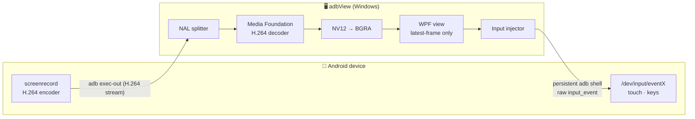
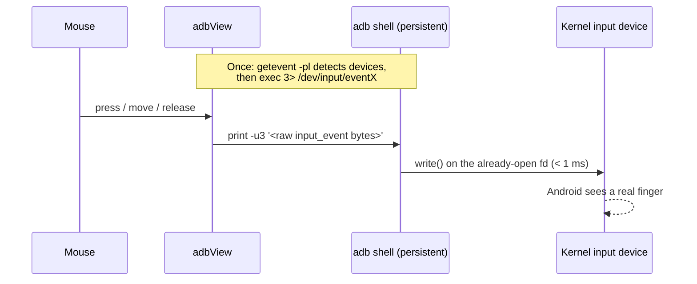

<div align="center">

# adbView

**Lightweight Android screen mirroring and control for Windows, over plain ADB.**

No app on the phone. No bundled native libraries. One small .NET executable.

[](#requirements)
[](https://dotnet.microsoft.com/download/dotnet/10.0)
[](#requirements)
[](LICENSE)
[](https://paypal.me/vudinhviet)

<br/>

[](https://github.com/vitvu/adbView/releases/latest)

</div>

---

## Download

Get the latest version from **[Releases](https://github.com/vitvu/adbView/releases/latest)**:

| File | Notes |
|---|---|
| `adbView-x.y.z-win-x64.zip` | **Recommended.** Self-contained: unzip and run, no .NET install needed. |
| `adbView-x.y.z-win-x64-lite.exe` | 0.2 MB. Requires the [.NET 10 Desktop Runtime](https://dotnet.microsoft.com/download/dotnet/10.0). |

## Highlights

| | |
|---|---|
| ⚡ **Sub-millisecond input** | Touch and keys are written straight to `/dev/input`. On older phones, `input tap` takes about 1 s per event. |
| 🎞️ **Native decoding** | H.264 from the phone's built-in `screenrecord`, decoded by Windows Media Foundation. |
| 🎯 **Smart quality** | *Auto* matches the stream to your window size. Only resolutions the device supports are offered. |
| 🔌 **Zero setup** | Plug in a USB cable and the screen appears. Devices are tracked with `adb track-devices`, with no polling. |
| 📱 **Phone-like UI** | Edge-to-edge screen and a window sized to the device's aspect ratio. Nav buttons appear only on phones that need them. |
| 🌗 **Light / Dark** | Follows the Windows theme, or can be set manually. UI in English or Tiếng Việt. |
| 🪶 **Lightweight** | About 100 MB RAM. Resources are freed when viewing stops, and child processes are cleaned up even on a crash. |

## Requirements

- Windows 10 (1809+) or Windows 11, x64
- [.NET 10 Desktop Runtime](https://dotnet.microsoft.com/download/dotnet/10.0) (lite build only)
- [`adb`](https://developer.android.com/tools/releases/platform-tools) available in `PATH`, in the Android SDK, or next to `adbView.exe`
- An Android 5.0+ device with **USB debugging** enabled

## Quick start

1. On the phone, enable **Developer options → USB debugging**.
2. Connect the phone by USB and run `adbView.exe`.
3. Accept the **Allow USB debugging** prompt on the phone. The screen appears automatically.

Use **⚙ Settings** to switch device, quality, language or theme.

### Wireless (Wi-Fi / LAN, no cable)

- **USB → Wi-Fi:** with the phone plugged in, open **⚙ Settings → Switch USB device to Wi-Fi**. adbView runs `adb tcpip 5555`, finds the phone's IP and connects. You can then unplug the cable.
- **Connect by IP:** type `IP` or `IP:port` (default port `5555`) and press **Connect**.
- **Android 11+ Wireless debugging (no cable at all):** on the phone open **Developer options → Wireless debugging → Pair device with pairing code**. Enter the pairing `IP:port` and the 6-digit code, press **Pair**, then enter the `IP:port` shown on the Wireless debugging screen and press **Connect**.

Connected addresses are remembered and reconnected automatically on the next launch. Over the network the bitrate is lowered a little to keep the stream smooth.

### Controls

| Input | Action on the phone |
|---|---|
| Click · hold · drag | Tap · long press · swipe |
| Mouse wheel | Scroll |
| Right click / `Esc` | Back |
| Typing, `Enter`, `Backspace`, arrows | Keyboard input |
| Toolbar | Power, volume ±, screenshot (saved to `Pictures\adbView`) |

### Quality levels

| Level | Resolution (short side) | Bitrate |
|---|---|---|
| Auto | Smallest level that stays sharp at the current window size | — |
| Low | 480p | 1.5 Mbps |
| Medium | 720p | 3 Mbps |
| High | 1080p | 6 Mbps |
| Very high | 1440p | 10 Mbps |
| Original | Native | 12 Mbps |

Levels at or above the device's native resolution are hidden.

## Architecture



### Input path: why it is fast



`input tap` starts a Java VM on the phone for every event. adbView skips it and writes events directly to the input device through a shell built-in, so no process is spawned per event.

### Project layout

| File | Responsibility |
|---|---|
| [`ScreenStream.cs`](ScreenStream.cs) | Runs `screenrecord`, splits Annex-B NAL units, converts color, hands frames to the UI with no blocking |
| [`H264Decoder.cs`](H264Decoder.cs) | Media Foundation decoder MFT driven through raw COM vtables, with no interop wrappers |
| [`InputInjector.cs`](InputInjector.cs) | Discovers touch and key devices and writes `input_event` records directly; falls back to `input` commands |
| [`MainWindow.xaml(.cs)`](MainWindow.xaml.cs) | UI, device tracking, quality selection, coordinate mapping |
| [`Tools.cs`](Tools.cs) | adb helpers, settings, localization, job object for child-process cleanup |

## Build from source

```bash
git clone https://github.com/vitvu/adbView.git
cd adbView
dotnet build -c Release

# single-file executable (requires .NET 10 runtime)
dotnet publish -c Release -p:PublishSingleFile=true -o publish
```

## Known limitations

- `screenrecord` stops every 3 minutes and adbView restarts it, causing a pause of about 1 s.
- Decoding runs on the CPU. 1080p at 30 fps uses about one core; pick *Medium* to reduce this.
- Text input is ASCII only, and touch mapping assumes portrait orientation.
- If `shell` cannot write to `/dev/input`, input falls back to the slower `input` commands.

## Roadmap

- [x] ADB over Wi-Fi (connect, pair, USB → Wi-Fi)
- [ ] Multi-device grid view
- [ ] GPU decoding and rendering (D3D11)
- [ ] Landscape and rotation support
- [ ] Unicode text input

## Contributing

Issues and pull requests are welcome. Please include the device model, Android version, and `%TEMP%\pv_stats.log` (run with `PV_DEBUG=1`) when reporting streaming problems.

## Support

If adbView saves you time, consider buying me a coffee ☕

<a href="https://paypal.me/vudinhviet"></a>

## License

Released under the [MIT License](LICENSE).
